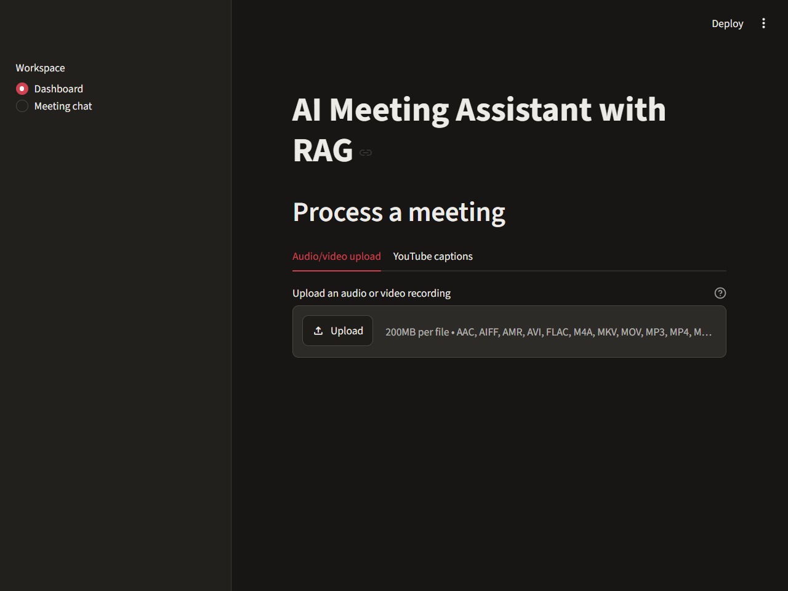
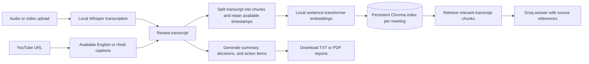
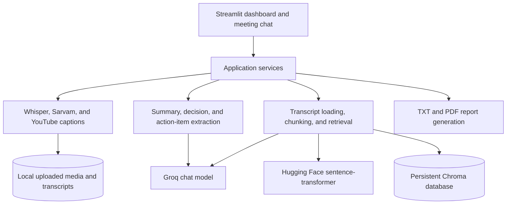

# AI Meeting Assistant with RAG

A Streamlit application for transcribing meetings, generating structured
insights, and asking questions grounded in meeting transcripts.



## Features

- Transcribe audio and video locally with Whisper, or load available English
  and Hindi captions from YouTube.
- Generate structured summaries, extract explicit decisions and action items,
  and retain missing owners or deadlines as unspecified.
- Index each transcript in a persistent, meeting-specific Chroma collection
  and ask transcript-grounded questions with source references.
- Keep follow-up chat context within a meeting; clear chat history when needed.
- Download transcript, summary, and action-item reports as TXT or PDF.
- Process files locally by default. Groq and Sarvam are optional external
  services used only for the features that need them.

## How it works





## Setup

The following commands use Windows PowerShell. From the project directory:

```powershell
python -m venv .venv
.\.venv\Scripts\Activate.ps1
python -m pip install --upgrade pip
python -m pip install -r requirements.txt
Copy-Item .env.example .env
```

Set `GROQ_API_KEY` and `GROQ_MODEL` in `.env` before generating meeting
insights or asking questions. Keep `.env` private; it is excluded by
`.gitignore`.

## Run

```powershell
.\.venv\Scripts\python.exe run.py
```

Choose **Dashboard** to upload a recording or load captions. Review the
transcript, then use **Index transcript for meeting chat** and/or **Generate
meeting insights**. In **Meeting chat**, enter the meeting ID shown with the
transcript and ask a question.

The first local Whisper or embedding-model use may download model files.

## Configuration

All settings are read from `.env`; relative storage paths are resolved from the
project directory.

| Variable | Default | Description |
| --- | --- | --- |
| `GROQ_API_KEY` | *(empty)* | Groq API key; required for meeting insights and generated chat answers. |
| `GROQ_MODEL` | *(empty)* | Groq chat model identifier; required when using Groq features. |
| `SARVAM_API_KEY` | *(empty)* | Optional API key for hosted Sarvam transcription. |
| `SARVAM_MODEL` | `saaras:v4` | Sarvam transcription model. |
| `WHISPER_MODEL` | `base` | Local Whisper model size/name. |
| `EMBEDDING_MODEL` | `sentence-transformers/all-MiniLM-L6-v2` | Hugging Face sentence-transformer model used for retrieval. |
| `CHROMA_DB_PATH` | `data/vectorstore` | Persistent Chroma database directory. |
| `UPLOAD_DIR` | `data/uploads` | Uploaded media and saved transcript directory. |
| `EXPORT_DIR` | `exports` | Runtime export directory; downloadable reports are generated in memory. |
| `MAX_UPLOAD_SIZE_MB` | `500` | Application-side uploaded-file size limit. |
| `PDF_FONT_PATH` | *(automatic)* | Optional `.ttf` or `.ttc` font path for PDF text outside the built-in font coverage. |

Streamlit's file uploader also has its own upload limit, which defaults to
200 MB. The effective upload limit is the lower of that Streamlit limit and
`MAX_UPLOAD_SIZE_MB`; adjust Streamlit's `server.maxUploadSize` setting if you
need to accept larger files.

## Providers and limitations

- **Whisper:** local transcription; speaker identification is not provided.
  The selected model is downloaded on first use if it is not cached.
- **Sarvam:** optional hosted transcription. Audio is sent to Sarvam when this
  provider is used; its synchronous endpoint is intended for short clips
  (under 30 seconds).
- **YouTube:** the app fetches available English or Hindi captions only. It
  does not download the video, and it cannot transcribe videos without
  accessible captions.
- **Groq:** meeting transcripts or retrieved transcript excerpts are sent to
  Groq when generating insights or answering questions. Do not send sensitive
  meeting content to an external provider unless authorized.
- **Retrieval:** answers use retrieved transcript excerpts and include source
  references. When no relevant chunks are retrieved, the app abstains rather
  than making an LLM request.
- **Persistence:** uploaded media, saved transcripts, and the Chroma index stay
  in the configured local directories. Dashboard insights and chat history
  live in the active Streamlit session.

## Tests

Run the offline test suite from PowerShell:

```powershell
.\.venv\Scripts\python.exe -m pytest -q
```

Tests mock Groq, Sarvam, YouTube, and Whisper; they do not make paid API calls
or download model weights. They cover transcription and conversion, persistent
Chroma indexing and meeting isolation, structured analysis, grounded chat and
abstention, report content, and dashboard behavior.

## Project layout

```text
app/
  agents/         Structured meeting summaries, decisions, and action items
  rag/            Transcript loading, chunking, Chroma indexing, and chat
  transcription/  Whisper, Sarvam, YouTube captions, and shared result models
  ui/             Streamlit dashboard and meeting-chat views
  utils/          File handling and TXT/PDF report generation
tests/            Offline unit and integration tests
docs/images/      README screenshots
run.py            Streamlit launcher
```
